# Estrutura Analítica do Projeto (EAP) — ArPuro

A EAP divide o projeto em entregas menores até o nível de pacote de trabalho. A versão é simplificada: três níveis, organizados por entrega.

## Diagrama

```mermaid
flowchart TD
    A[ArPuro - Aplicativo de Qualidade do Ar]

    A --> B[1. Gerenciamento]
    A --> C[2. Modelagem e Documentação]
    A --> D[3. Infraestrutura]
    A --> E[4. Interface]
    A --> F[5. Funcionalidades]
    A --> G[6. Qualidade]
    A --> H[7. Entrega Final]

    B --> B1[1.1 Escopo]
    B --> B2[1.2 EAP]
    B --> B3[1.3 Planejamento de sprints]
    B --> B4[1.4 README e CHANGELOG]

    C --> C1[2.1 Diagrama de casos de uso]
    C --> C2[2.2 Diagrama de classes]
    C --> C3[2.3 Modelagem do banco]
    C --> C4[2.4 Mapeamento Dart - Firestore]
    C --> C5[2.5 Fluxo de navegação]
    C --> C6[2.6 Registro de uso de IA]

    D --> D1[3.1 Projeto Flutter em camadas]
    D --> D2[3.2 Tema e identidade visual]
    D --> D3[3.3 Configuração do Firebase]
    D --> D4[3.4 Gerenciamento de estado]

    E --> E1[4.1 Splash com entrada anônima]
    E --> E2[4.2 Home - Semáforo]
    E --> E3[4.3 Mapa de focos]
    E --> E4[4.4 Câmera e Nova Denúncia]
    E --> E5[4.5 Saúde]
    E --> E6[4.6 Perfil local]

    F --> F1[5.1 Autenticação anônima]
    F --> F2[5.2 API de qualidade do ar e cache]
    F --> F3[5.3 CRUD de denúncias]
    F --> F4[5.4 Upload de fotos]
    F --> F5[5.5 Sincronização offline]
    F --> F6[5.6 Google Maps]
    F --> F7[5.7 Alertas, histórico e PDF]
    F --> F8[5.8 Perfil local e XP]

    G --> G1[6.1 Testes automatizados]
    G --> G2[6.2 Testes no emulador]
    G --> G3[6.3 Correção de bugs]

    H --> H1[7.1 Revisão da documentação]
    H --> H2[7.2 Apresentação]
    H --> H3[7.3 Entrega do repositório]
```

## Dicionário da EAP

| Código | Pacote de trabalho | Descrição | Status |
| :---: | :--- | :--- | :---: |
| **1** | **Gerenciamento** | | |
| 1.1 | Escopo | Definição do que está dentro e fora do projeto (`docs/escopo.md`) | Concluído |
| 1.2 | EAP | Este documento | Concluído |
| 1.3 | Planejamento de sprints | Divisão semanal das entregas (`docs/sprints.md`) | Concluído |
| 1.4 | README e CHANGELOG | Responsabilidades reais e histórico de mudanças | Contínuo |
| **2** | **Modelagem e Documentação** | | |
| 2.1 | Diagrama de casos de uso | Atualizado com as regras do aditivo (`docs/caso_uso.jpg`) | Concluído |
| 2.2 | Diagrama de classes | Entidades de domínio, atributos, métodos e relacionamentos (`docs/diagrama_classes.png`) | Concluído |
| 2.3 | Modelagem do banco | Coleções e documentos do Firestore (`docs/modelagem_banco_dados.png`) | Concluído |
| 2.4 | Mapeamento Dart - Firestore | Como as classes Dart viram documentos (`docs/Mapeamento_Dominio_Dart.jpg`) | Concluído |
| 2.5 | Fluxo de navegação | Conexão real entre as telas (`docs/fluxograma_telas.jpg`) | Concluído |
| 2.6 | Registro de uso de IA | Prompts, erros e bibliotecas (`docs/uso-de-ia.md`) | Concluído |
| **3** | **Infraestrutura** | | |
| 3.1 | Projeto Flutter em camadas | Estrutura `lib/features/<feature>/{data,domain,presentation,widgets}` | Concluído |
| 3.2 | Tema e identidade visual | `AppColors` e `AppTheme` em modo claro e alto contraste | Concluído |
| 3.3 | Configuração do Firebase | `flutterfire configure`, `firebase_options.dart` e inicialização | Pendente |
| 3.4 | Gerenciamento de estado | Riverpod (`ProviderScope` configurado; providers por feature) | Em andamento |
| **4** | **Interface** | | |
| 4.1 | Splash com entrada anônima | Splash concluída; falta chamar a autenticação anônima ao abrir. Não há tela de login, pois o app é anônimo (`docs/escopo.md`, seção 5.1) | Em andamento |
| 4.2 | Home - Semáforo | Semáforo AQI, card de saúde e modal do índice | Concluído |
| 4.3 | Mapa de focos | Marcadores, filtros, busca e detalhe do foco | Concluído |
| 4.4 | Câmera e Nova Denúncia | Câmera, GPS, categoria, anonimato, modal de sucesso e estado offline | Concluído |
| 4.5 | Saúde | Check-in respiratório, alerta e previsão sazonal, recomendações | Concluído |
| 4.6 | Perfil local | Cartão com nome, nível e XP; estatísticas; perfil de saúde, notificações, modo anônimo e exportação. Tela pronta, mas ainda com nome e XP fixos no código | Em andamento |
| **5** | **Funcionalidades** | | |
| 5.1 | Autenticação anônima | `signInAnonymously()` do Firebase Auth, sem login nem dado pessoal; UID usado só nas regras de segurança e nas preferências, nunca nas denúncias | Pendente |
| 5.2 | API de qualidade do ar e cache | HTTP + JSON, timeout de 10 s, cache com validade e aviso "Desatualizado" | Pendente |
| 5.3 | CRUD de denúncias | Criar, listar e confirmar/resolver denúncias no Firestore | Pendente |
| 5.4 | Upload de fotos | Compressão, remoção do EXIF e envio ao Firebase Storage com loading | Pendente |
| 5.5 | Sincronização offline | Fila local de denúncias e envio quando houver conexão | Pendente |
| 5.6 | Google Maps | Mapa real, marcadores coloridos e agrupamento | Pendente |
| 5.7 | Alertas, histórico e PDF | Alertas de piora, favoritos, histórico, gráficos e exportação | Pendente |
| 5.8 | Perfil local e XP | Nome padrão "Usuário" editável, XP e nível por denúncia e contadores, tudo salvo só no aparelho com `shared_preferences` | Pendente |
| **6** | **Qualidade** | | |
| 6.1 | Testes automatizados | Testes de widget e de unidade (mínimo de três) | Em andamento |
| 6.2 | Testes no emulador | Execução do app completo no Android | Contínuo |
| 6.3 | Correção de bugs | Inclui erros de código gerado por IA | Contínuo |
| **7** | **Entrega Final** | | |
| 7.1 | Revisão da documentação | Conferência de todos os itens da avaliação | Pendente |
| 7.2 | Apresentação | Slides e roteiro da defesa oral | Pendente |
| 7.3 | Entrega do repositório | Link postado no Teams | Pendente |
